<p align="center">
  <picture>
    <source media="(prefers-color-scheme: dark)" srcset="docs/assets/hero-dark.svg">
    
  </picture>
</p>

<p align="center">
  <a href="https://github.com/rajanalamuri/mlfingerprint/actions/workflows/ci.yml"></a>
  <a href="https://github.com/rajanalamuri/mlfingerprint/actions/workflows/security.yml"></a>
  
  
  
</p>

# mlfingerprint

**A lockfile for your training data.** Every dataset version gets a fingerprint: a manifest describing exactly which bytes were in it, how it was split, where it came from, and which models were trained on it. It works for any modality (video, frames, audio, images, radar, lidar, IMU, text, tabular, time series) on any storage (local, S3, Azure, GCS, Databricks, HDFS, HF…).

```bash
pip install mlfingerprint             # zero dependencies: local disks, Databricks /Volumes + /dbfs
pip install "mlfingerprint[s3]"       # + S3 / MinIO / R2        [azure] [gcs] [databricks] [hf] [cloud] [all]
```

```python
import mlfingerprint as fp

v  = fp.commit("s3://raw/drives", "s3://ml/ledgers/drives", message="added 3 batches")  # version
ds = fp.load("s3://ml/ledgers/drives", "prod")                                         # retrieve (tag or 1.2.0)
ds.files("train"); ds.samples("val"); ds.to_torch("train", loader)                     # use
fp.record_training("model-v1", [ds], {"acc": 0.94}, recipe={"hflip": 0.5}, seed=42)    # trace
```

No server, no database, no account. A version is a folder of small files next to your data.

---

## The idea

<picture>
  <source media="(prefers-color-scheme: dark)" srcset="docs/assets/concept-dark.svg">
  
</picture>

**Version the description, not the data.** Blobs stay where they are. Each version is an immutable folder:

```
<ledger root>/                      local · s3:// · az:// · abfss:// · gs:// · dbfs:/ · /Volumes/… · hdfs:// · hf://
├── ledger.json   tags.json
├── objects/ab/cdef….png            ← only in mode="cas" (deduplicated across versions)
├── drives-v1.0.0/
│   ├── manifest.json               ← the contract: fingerprint, split checksums, lineage, parents, stats, quality
│   ├── index.jsonl.gz              ← one row per file: path, split, label, size, sha256, modality, sensor meta
│   ├── splits/train.txt            ← ready-made file lists (absolute URIs)
│   └── usage.jsonl                 ← every model trained on it (metrics, recipe, seed)
└── drives-v1.1.0/ …
```

- **Fingerprint** = a hash over every file's path, split and SHA-256. If any byte, file, rename or split assignment changes, the fingerprint changes.
- **Retrieval** = read one manifest, read one index, then stream files straight from storage into your loader.
- **Traceability** = models store `ds.lock()` (version + fingerprint + split checksums + manifest URI). `fp.load_lock(lock)` reopens the exact data later, and refuses if the ledger was altered.

| Mode | Data | When |
|---|---|---|
| `reference` (default) | stays in place, zero copy; `verify()` detects drift | write-once raw prefixes (best with S3 Object Lock / bucket versioning) |
| `cas` | content-addressed snapshot; identical files stored once across all versions | sources that change in place |
| `copy` / `hardlink` | per-version snapshot | small datasets, local disks |

## Works for every ML task

| Task | Layout it understands | What it guarantees |
|---|---|---|
| **Classification** | `train/cat/1.jpg`, `0/…9/` | labels + class balance per split |
| **Detection / segmentation** | `images/x.jpg` + `labels/x.txt` / `masks/x.png`; COCO `instances_train2017.json`, `train2017/` | image and annotation always in the same split; `label_format="yolo"` reports objects per class per split |
| **Video / frames** | `seq_014/frame_000123.png` (video divided at a fixed fps) | a sequence never straddles splits; frame counts per sequence |
| **Multi-sensor** (AV, robotics, wearables) | `drive_03/{camera,radar,imu,lidar,gnss,can,mic}/…` | a recording stays in one split; sensors stay time-synced |
| **Audio / speech** | `speaker_07/utt_3.wav`, `train/…` | duration, sample rate; `group_by="parent"` keeps a speaker in one split |
| **NLP** | `train.jsonl`, `dev.csv`, HF `test-0001-of-0004.parquet` | record-level label balance; **flags the same sentence in train and test** |
| **Time-series forecasting** | `2026-05-08/imu.csv`, epoch filenames, timestamp columns | `split="temporal"`: past → train, future → test; overlap check; row-level cutoffs for one long series |
| **Tabular** | csv / parquet | rows, columns, record overlap |

Sensor folders set the modality even for generic files (`radar_front/0001.bin` → radar, `imu0/data.npy` → imu). Add your own with `fp.register_sensor("sonar", "sonar", "sss")`, `fp.register_rule("radar", "*.rdc")` or `--modality radar='*/mmwave/**'`.

## Leakage checks (built in, on every commit)

| Check | Catches |
|---|---|
| auto grouping (`group_by="auto"`) | frames, recordings, sensor streams, image+label pairs, augmented copies split apart |
| augmentation detection (`img_001_hflip.png`, `utt3_speed1.1.wav`, `aug/`, `synthetic/`) | an augmented copy in a different split than its original; augmented data in val/test |
| exact duplicates | the same file content in two splits |
| record overlap (text/csv/jsonl) | the same normalised sentence/row in train and val/test |
| parent check (derived datasets) | training files copied or augmented from a parent's val/test split |
| temporal check | training window overlapping the test period |
| split drift (diff) | files that moved split between versions (e.g. test → train) |

Warnings are logged and stored in `manifest.quality` and `manifest.lineage.warnings`. Set `augmentation="error"` to fail CI on augmentation leaks.

## Data added, derived and augmented

```python
raw = lg.commit("s3://raw/drives", message="batch 05-10")                # 1.1.0 → 1.2.0 automatically

# offline augmentation / filtering / relabelling = a derived dataset with parents
aug = fp.commit("s3://aug/drives", "s3://ml/ledgers/drives-aug",
                parents=[raw, {"type": "delta", "table": "main.ml.labels", "version": 42}],
                transformations=[{"name": "hflip"}, {"name": "rain", "p": 0.3}])
aug.trace()           # full ancestry tree
aug.check_lineage()   # ["stale: derived from drives-v1.2.0, parent now at drives-v1.3.0"]

# on-the-fly augmentation isn't in the data, so it goes in the training record
fp.record_training("model-v4", [raw, aug, text_ds], {"mAP": 0.61},
                   recipe={"random_crop": 0.5, "specaugment": True}, seed=1234)
```

**Automatic semantic versions** (`bump="auto"`):

| Change | Version bump |
|---|---|
| new modality/sensor | major |
| files added | minor |
| removals/fixes | patch |
| nothing changed | no new version (CI-safe) |

**Tags**: `lg.tag("1.2.0", "prod")` → `fp.load(root, "prod")`, with tag history kept.

## Time-series forecasting

```python
fp.commit("s3://iot/load", L, split="temporal", probe=True)                    # 80/10/10 by time
fp.commit("s3://iot/load", L, time_cutoffs={"val": "2026-05-01", "test": "2026-05-15"})
fp.commit("./one_series", L, split="none",                                       # one long CSV
          row_split={"column": "timestamp", "val_from": "2026-05-01", "test_from": "2026-05-15"})
ds.split_for_time(row["timestamp"])   # -> 'train' | 'val' | 'test' inside your loader
```

Time comes from timestamp columns (`--probe`; ns/µs/ms/s epochs or ISO), dates or epochs in paths, or local mtimes.

## CLI

<picture>
  <source media="(prefers-color-scheme: dark)" srcset="docs/assets/cli-dark.svg">
  
</picture>

```bash
export FINGERPRINT_ROOT=s3://ml/ledgers/drives
fingerprint commit s3://raw/drives -n drives -m "batch 05-10" -t "dropped frames with gaps > 5s" --probe
fingerprint commit s3://aug/drives -L s3://ml/ledgers/drives-aug --parent s3://ml/ledgers/drives@1.2.0
fingerprint log | show prod | diff 1.1.0 1.2.0 | lineage | tags
fingerprint tag prod 1.2.0 -m "shipped with model-v4"
fingerprint verify prod --sample 0.05        # exit 1 on failure → CI gate   (--quick: size only)
fingerprint checkout prod ./data --split val --mode hardlink
fingerprint files prod --split train > train.txt
fingerprint lock prod                         # JSON to store with the model
```

## Integrations

- **PyTorch**: `ds.to_torch("train", loader=lambda f, rec: decode(f.read()))`
- **MLflow**: `ds.log_mlflow()` logs tags plus `dataset_lock.json`
- **Feature stores / W&B / anything**: `ds.tags_dict()` gives `{dataset, dataset_version, dataset_fingerprint}`. Write it into feature-table properties so features trace back to raw data.
- **CI**: `commit` is idempotent; `verify` exits non-zero; commits are protected against two jobs writing the same version.

## Storage

| URI | Extra | Notes |
|---|---|---|
| `/path`, `/Volumes/…`, `/dbfs/…` | – | local + Databricks clusters |
| `dbfs:/…` | `databricks` | FUSE on-cluster, REST off-cluster (`DATABRICKS_HOST`, `DATABRICKS_TOKEN`) |
| `s3://` | `s3` | `AWS_ENDPOINT_URL` for MinIO / R2 / Ceph |
| `az://`, `abfs://`, `abfss://` | `azure` | `storage_options={"account_name": …}` or a connection string |
| `gs://` | `gcs` | |
| `hf://`, `hdfs://`, `sftp://`, … | `hf` / any fsspec driver | |

Source and ledger can be on different clouds. Big buckets are listed in parallel per prefix, and re-commits only re-hash files whose ETag/mtime changed.

## Where it fits

Upstream of a feature store, alongside your experiment tracker. If you outgrow it (hundreds of interdependent versions, collaborative labelling), the manifests remain plain JSON you can migrate.

## Benchmarks

Run on **MNIST**, **Fashion-MNIST** (70,000 images each) and the full **COCO 2017** annotation set (122,224 files,
886,282 objects) plus real COCO images. Every number is cross-checked against ground truth computed independently
of mlfingerprint. Full report and how to reproduce it: [benchmarks/RESULTS.md](benchmarks/RESULTS.md).

| 70,000 files, 2 vCPUs | MNIST | Fashion-MNIST |
|---|---:|---:|
| First commit | 19.8 s | 21.5 s |
| Re-commit, nothing changed | 7.1 s | 7.0 s |
| `verify` full re-hash / 5 % sample | 4.0 s / 0.17 s | 3.6 s / 0.40 s |
| One-pixel edit caught · augmentation leak flagged | ✅ · ✅ | ✅ · ✅ |
| Exact train/test duplicates found (= ground truth) | 0 | 0 |

| COCO 2017 annotations, 122,224 files | |
|---|---:|
| First commit (hash + count 886k objects by class) / re-commit, no change | 35.1 s / 23.4 s |
| `verify` full / 5 % sample | 9.9 s / 0.88 s |
| Val objects vs official `instances_val2017.json` (non-crowd) | 36,335 = 36,335 ✅ |
| Edited box caught · copied val label in train flagged · image+label pairs kept together | ✅ · ✅ · ✅ |

## Quality

Unit, integration (S3, Azure, GCS emulators) and security test suites run in CI on Linux and macOS for Python 3.9–3.13, alongside bandit, CodeQL, pip-audit, gitleaks and OpenSSF Scorecard. Releases are built once, carry provenance attestations, and go out through PyPI Trusted Publishing. See [SECURITY.md](SECURITY.md) for the threat model.

MIT © Raj Alamuri · Alpha
